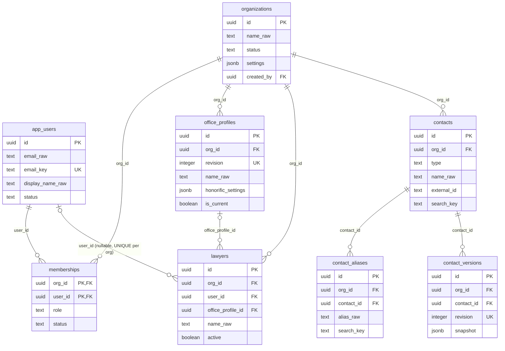
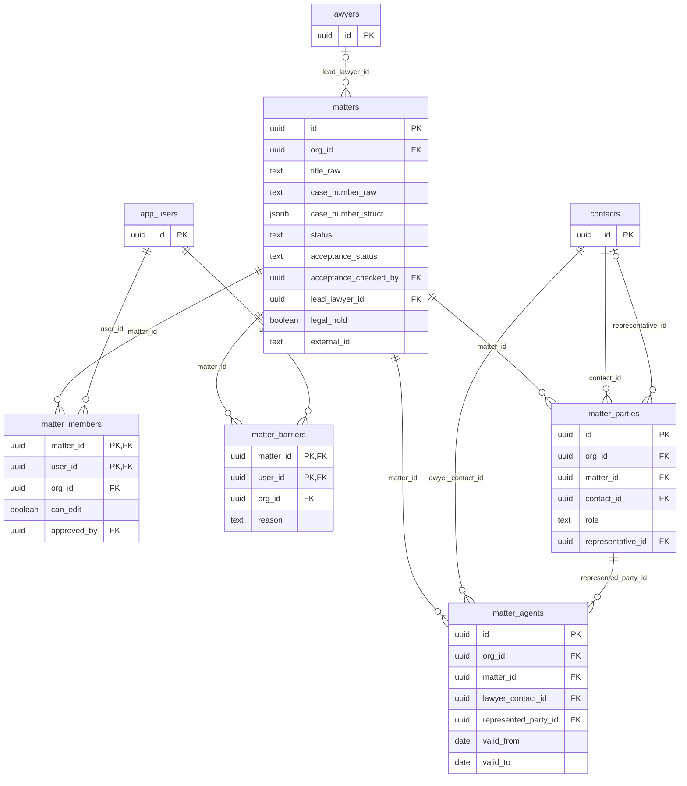
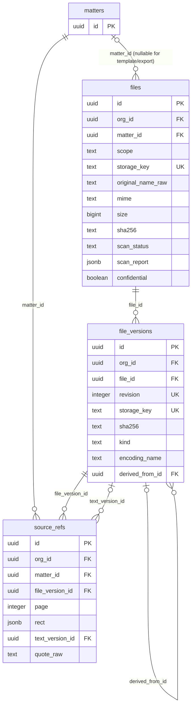
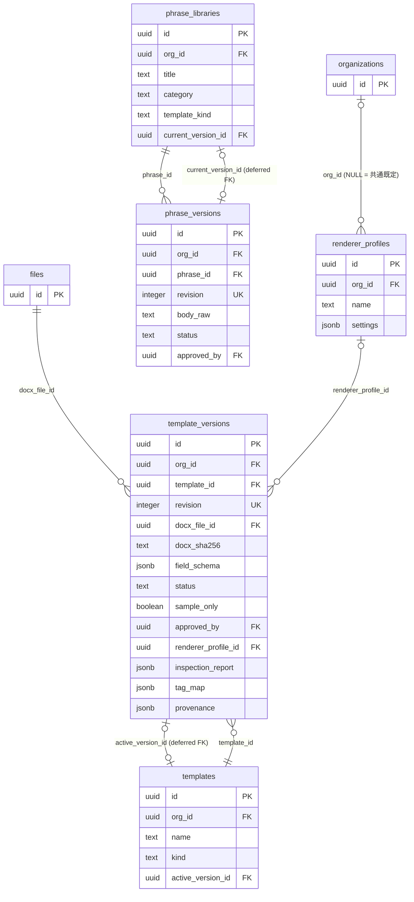
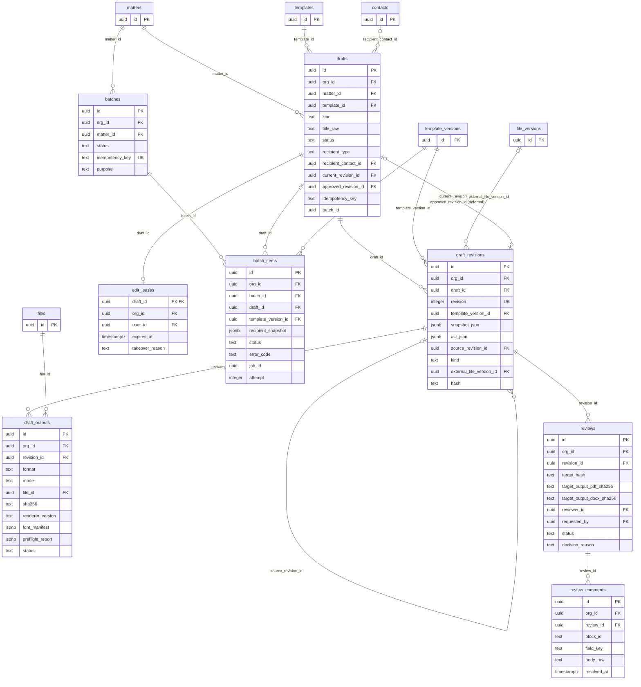
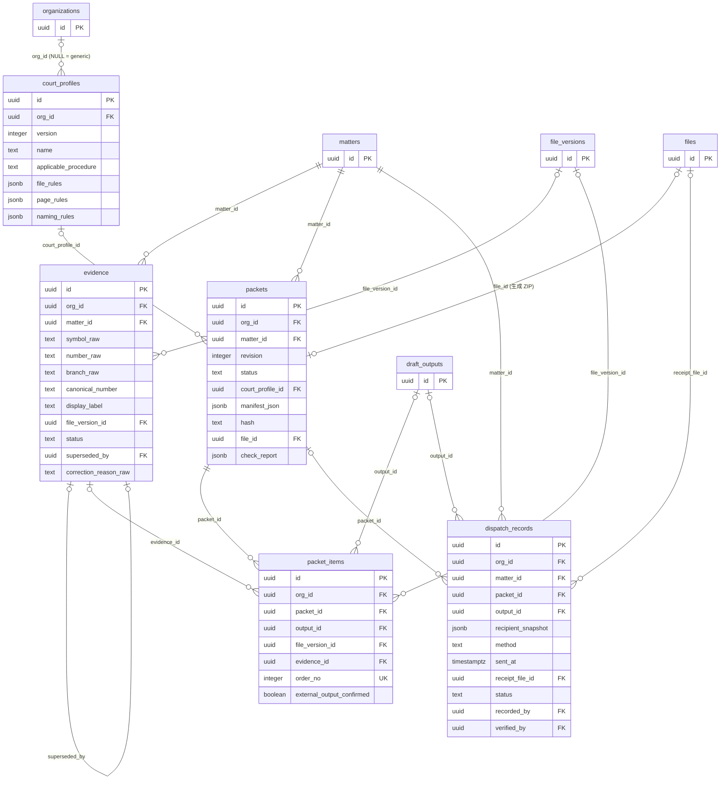
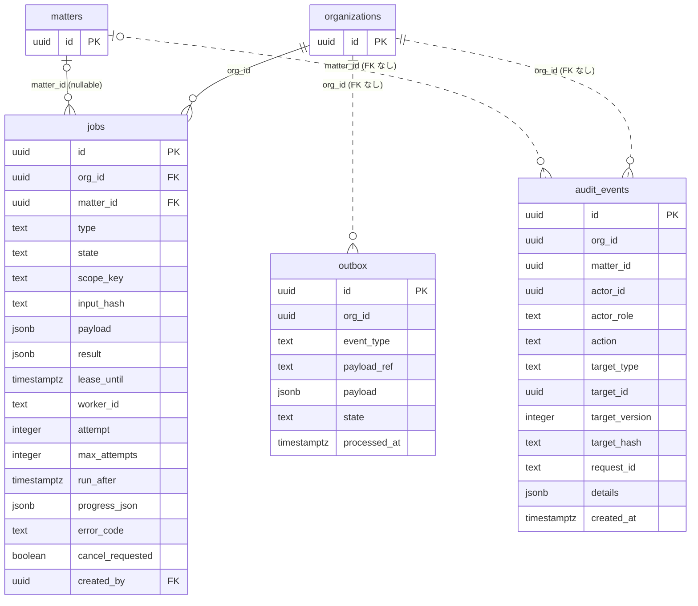
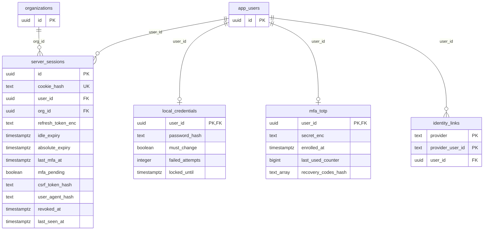

# RayLaw v2 ER 図

出典: `supabase/migrations/20261006000002_core_tables.sql`（public）、`20261006000005_private_auth.sql`（private）。列の詳細は `docs/data-dictionary.md`。

凡例と前提:

- すべての業務テーブルは `org_id → organizations.id`（ON DELETE CASCADE）を持つ。読みやすさのため、各図では `organizations` との関係を代表的なテーブルのみ描き、他は属性 `org_id FK` で示す。`audit_events.org_id` と `outbox.org_id` は FK 制約なし。
- `created_by / approved_by / reviewer_id / recorded_by / verified_by` 等の `app_users` 参照は図では省略し、属性にのみ記載する。
- 遅延 FK（DEFERRABLE INITIALLY DEFERRED）: `templates.active_version_id`、`phrase_libraries.current_version_id`、`drafts.current_revision_id / approved_revision_id`。
- cross-org 参照は FK とは別に `app.tg_assert_same_org` トリガで拒否する（`docs/data-dictionary.md` のトリガ一覧）。

## 1. 組織・利用者・マスター

## 2. 案件と ACL

`matter_parties`（当事者）と `matter_agents`（代理人）は別の関係である。代理人は `contacts(type=lawyer)` を `represented_party_id` に紐づける。

## 3. ファイル・原資料

## 4. 書式・文例・描画設定

## 5. 草案・レビュー・一括生成

`drafts.batch_id` と `batch_items.job_id` は FK 制約のない参照列。

## 6. 証拠・提出パック・送付記録

## 7. ジョブ・監査・outbox

`jobs_dedupe_uq`（`org_id, type, scope_key, input_hash` / state IN queued,running）で同一入力の重複投入を防ぐ。

## 8. 非公開 schema `private`

`private` schema は `authenticated` / `anon` から REVOKE ALL。RLS を有効化しポリシーを置かないため、`service_role`（BYPASSRLS）だけが操作できる。BFF は `withServiceTx`（`apps/api/src/db/pool.ts`）経由でのみ触る。

## 9. テーブル群の説明

| 群 | テーブル | 役割 |
|---|---|---|
| 利用者・組織 | `app_users`, `organizations`, `memberships` | ログイン主体、事務所、所属と役割（admin/lawyer/staff）。`memberships` は org 単位の権限、案件アクセスは別途 `matter_members` |
| 事務所マスター | `office_profiles`, `lawyers` | 差出人情報は revision 制（更新は新 revision、`is_current` 1 件）。`lawyers.user_id` でログイン利用者と対応づけ、承認権限の判定に使う |
| 連絡先 | `contacts`, `contact_aliases`, `contact_versions` | 共有連絡先（人物/組織/弁護士）。別名は明示登録、更新ごとに snapshot を immutable 保存 |
| 案件 | `matters`, `matter_members`, `matter_barriers`, `matter_parties`, `matter_agents` | 事件情報、案件 ACL（member 必須、barrier 優先）、当事者と代理人（別関係） |
| ファイル | `files`, `file_versions`, `source_refs` | 原本 bytes（storage_key=UUID、sha256、quarantine→scan）、派生版（safe_preview / derived_pdf / native_text / ocr_text / submission_pdf）、引用参照 |
| 書式 | `renderer_profiles`, `templates`, `template_versions` | 書式カタログと版。版は DOCX file + sha256 + field_schema + provenance + inspection_report を固定。published は immutable |
| 文例 | `phrase_libraries`, `phrase_versions` | 所内文例と版・承認 |
| 草案 | `drafts`, `draft_revisions`, `draft_outputs`, `edit_leases` | 文書と immutable な版（snapshot_json + ast_json + hash）、出力物（docx/pdf × draft/final）、編集 lease |
| レビュー | `reviews`, `review_comments` | 承認対象 hash と出力 sha を固定した承認記録、ブロック/項目単位のコメント |
| 一括 | `batches`, `batch_items` | 20 書式 × 50 宛先の一括生成。子項目ごとに draft と job を持つ |
| 証拠 | `evidence` | 証拠番号（raw と canonical）、原資料版への参照、訂正は superseded + 新行 |
| 提出 | `court_profiles`, `packets`, `packet_items`, `dispatch_records` | 提出先 profile、提出パック（検査結果・manifest・ZIP）、手動の送付/提出記録と他担当者確認 |
| 基盤 | `jobs`, `audit_events`, `outbox` | job queue（claim/lease/retry）、append-only 監査、outbox（記録のみ。消費者は未実装） |
| private | `server_sessions`, `local_credentials`, `mfa_totp`, `identity_links` | BFF セッション、ローカル資格情報（scrypt）、TOTP secret（AES-256-GCM 暗号化）、Supabase Auth との ID 対応 |

`public._raylow_migrations` は `scripts/db-migrate.mjs` が作る適用履歴表（migration ファイル外）。
