# RayLaw v2 状態遷移

出典: `packages/domain/src/states.ts`（遷移表）、`supabase/migrations/20261006000002_core_tables.sql`（CHECK 制約）、`apps/api/src/routes/*.ts`（API 側遷移）、`apps/worker/src/**`（worker 側遷移）。各図の遷移ラベルは「操作 — 実行者」。状態名は DB の値。

遷移の実行者:

- **can_edit**: `app.can_edit_matter` を満たす案件メンバー（admin/lawyer/staff を問わない。案件が active であること）
- **access**: `app.can_access_matter` を満たすメンバー
- **assigned lawyer**: `app.is_assigned_lawyer`（案件 member ∧ role=lawyer ∧ lawyers 登録 ∧ barrier なし）
- **worker**: service_role の render worker（job handler）
- **admin / lawyer**: `memberships.role`

CHECK 制約で定義されるが、どのコード経路からも到達しない状態は「未到達」と明記する。

## 1. 草案 `drafts.status`

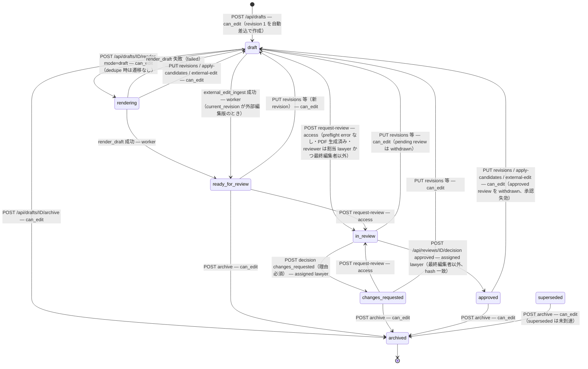

補足:

- `render_final`（mode=final）は status を変えない。承認済み revision（`approved_revision_id`）に対して `draft_outputs(mode=final)` を追加するだけ。sample_only 書式は 409。
- `superseded` は `states.ts` に定義があるが設定するコード経路がない（未到達）。
- 承認失効時 `approved_revision_id` 列はクリアされず、`status` が `draft` になることで正式出力が止まる（`GET /api/outputs/:id/download?mode=final` は `status='approved'` と `approved_revision_id = revision_id` を要求）。
- `draft_revisions` 自体は immutable。遷移はすべて `drafts.current_revision_id` の差し替えと `status` 更新で表現する。
- 編集系操作は `edit_leases` が他者保持中なら 409 `lease_held`。

## 2. 書式版 `template_versions.status`

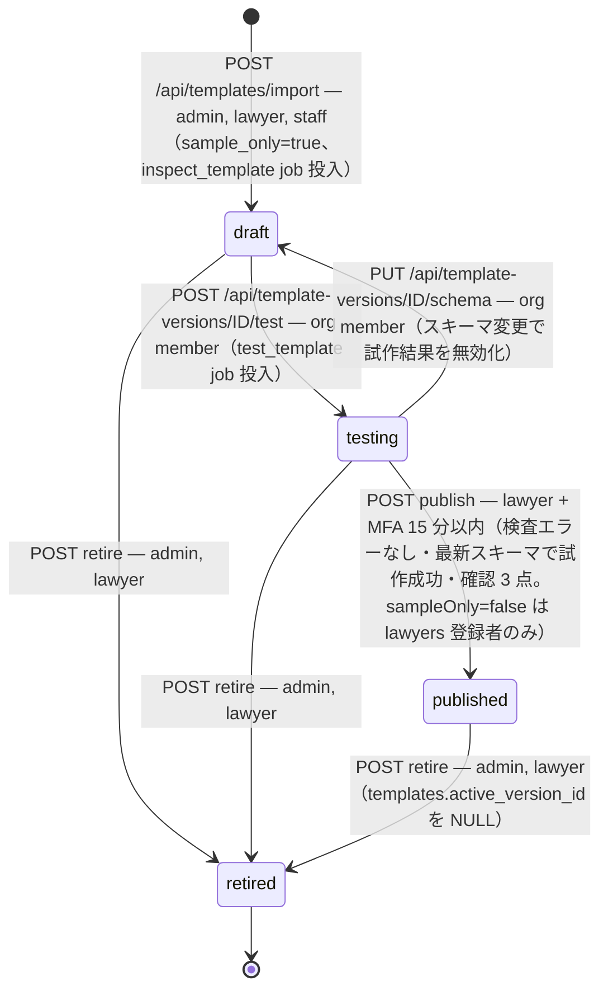

補足:

- `published` は DB トリガ `tg_template_version_immutable` で `field_schema / docx_file_id / docx_sha256 / tag_map / renderer_profile_id` を変更不可。status は `retired` へのみ。
- `draft → published` は `canTransitionTemplateVersion` で拒否（先に test が必要）。
- publish は既存の published 版を retire しない（過去文書は書き換わらない）。`templates.active_version_id` だけ新版へ切替。
- `inspect_template` job が構造的に拒否した場合（`template_rejected`）は status は `draft` のまま、`files.scan_status` が `rejected` になり、publish は `inspection_report.issues` にエラーがあるため 409。

## 3. ジョブ `jobs.state`

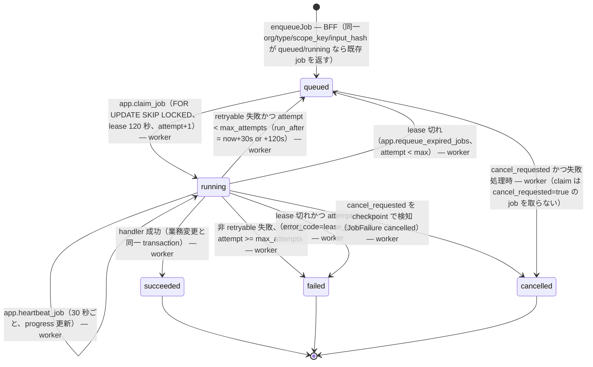

補足:

- `POST /api/jobs/:id/cancel`（can_edit）は `cancel_requested=true` を立てるだけ。queued の job は claim されなくなり、running の job は次の `progress()` で停止する。
- retryable な失敗コード: `timeout`, `converter_unavailable`, `scanner_unavailable`, `tool_unavailable`, `transient`（ECONNREFUSED）, `file_not_clean`（外部編集版の scan 待ち）, `lease_expired`。書式エラー（`unreplaced_tag`, `template_compile_error`, `template_rejected` 等）は再試行しない。
- 再試行遅延は `JOB_RETRY_DELAYS_SECONDS=[30,120]`（attempt 1 回目の失敗後 30 秒、以後 120 秒）。
- job 失敗時の副作用: `render_draft` → `drafts.status rendering→draft`、`batch_items` → failed/cancelled、`packets` → failed。
- `succeeded` への更新は `WHERE state='running' AND worker_id=自分` を条件にし、lease を失っていた場合は `lease_lost` として失敗扱い（二重成果物を防ぐ）。

## 4. レビュー `reviews.status`

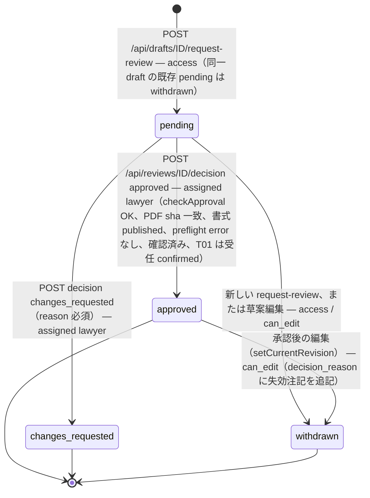

`reviews.version` は `expectedVersion` で楽観ロック。決定済み review への再決定は 409。

## 5. 一括生成 `batches.status` / `batch_items.status`

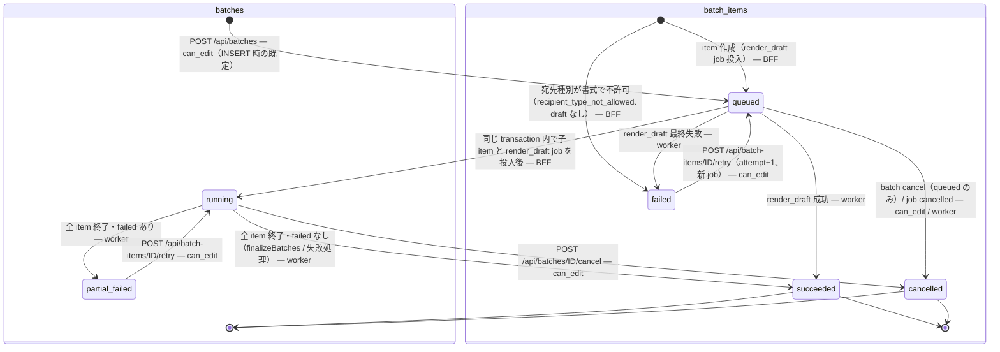

補足: `batch_items.status='running'` と `batches.status='failed'` は CHECK にあるが設定経路がない（未到達）。実行中かどうかは `jobs.state` で判断する。

## 6. 提出パック `packets.status`

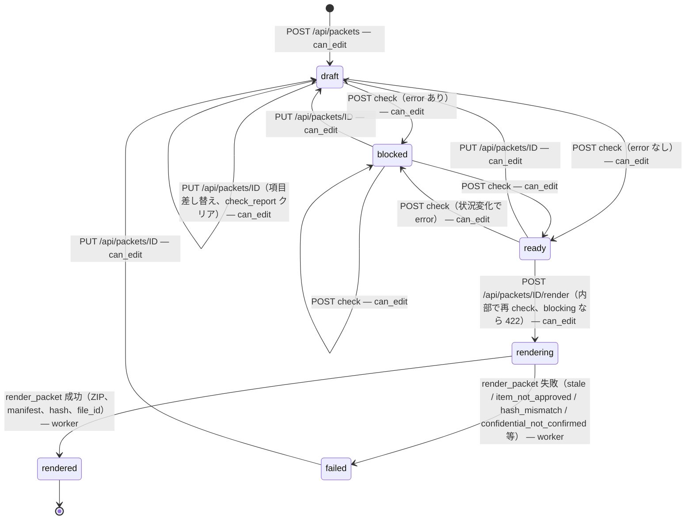

補足:

- `checking` と `archived` は CHECK にあるが未到達。
- render job は `packets.version` を payload に持ち、worker は一致しないと `stale` で失敗する（job 投入後の変更を拒否）。
- `rendered` / `archived` への `PUT` は 409（新しいパックを作る）。
- ZIP ダウンロードは `rendered` のみ。ダウンロードは提出済みを意味しない（送付記録で管理）。

## 7. 証拠 `evidence.status`

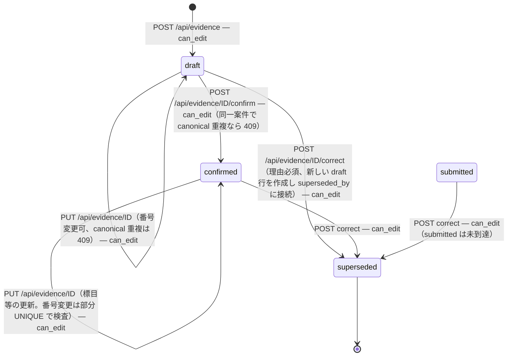

補足: `submitted` を設定する経路がない（提出パック出力や送付記録登録では evidence.status を変更しない）。`PUT` は `submitted/superseded` を 409 で拒否するよう書かれているが、submitted には到達しない。部分 UNIQUE `evidence_canonical_uq` は `confirmed/submitted` 行にのみ効く。

## 8. ファイル検査 `files.scan_status`

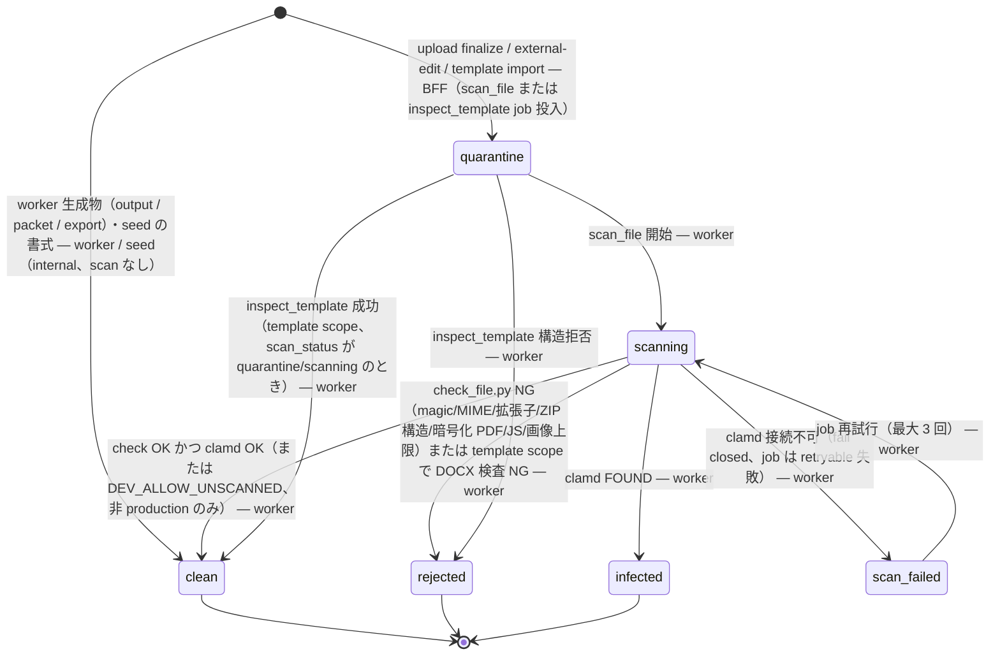

補足:

- `GET /api/files/:id/content` は `clean` 以外を 409（`file_quarantined` / `file_rejected` / `scanner_unavailable`）で拒否。
- PDF は `clean` 化時に派生安全版 `file_versions(kind=safe_preview)` を追加し、既定の取得対象にする。
- `scan_failed` が 3 回続くと job は `failed` のままで `files.scan_status='scan_failed'` が残る。復旧後は再アップロードまたは手動の job 再投入が必要（自動再検査なし）。

## 9. 案件 `matters.status` / `matters.acceptance_status`

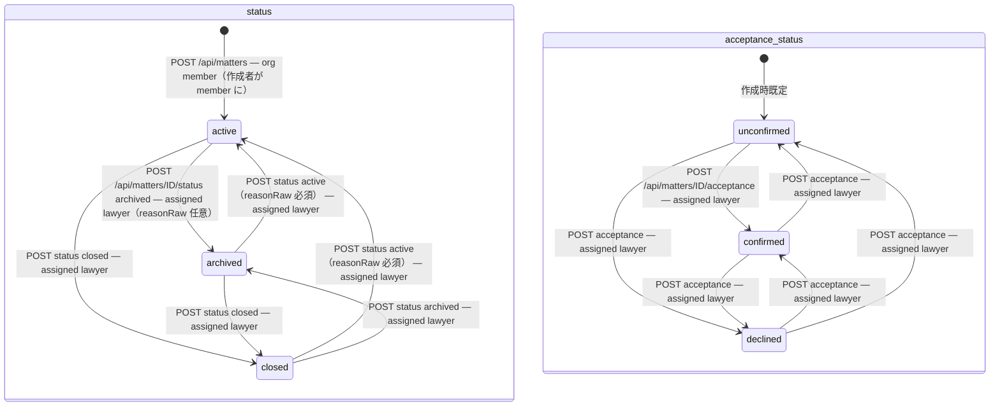

補足:

- `active` 以外では `app.can_edit_matter` が false になり、草案・証拠・ファイル等の書込みが RLS で止まる（閲覧は可）。`status` 列自体の更新は `matters_update` ポリシー（access ∧ can_edit 行）で許可される。
- `legal_hold=true` の間は `matters` の DELETE がトリガで拒否される（API に DELETE は無く、RLS `matters_delete` も false）。
- `acceptance_status='confirmed'` は T01（受任通知）の承認条件。

## 10. 送付/提出記録 `dispatch_records.status`

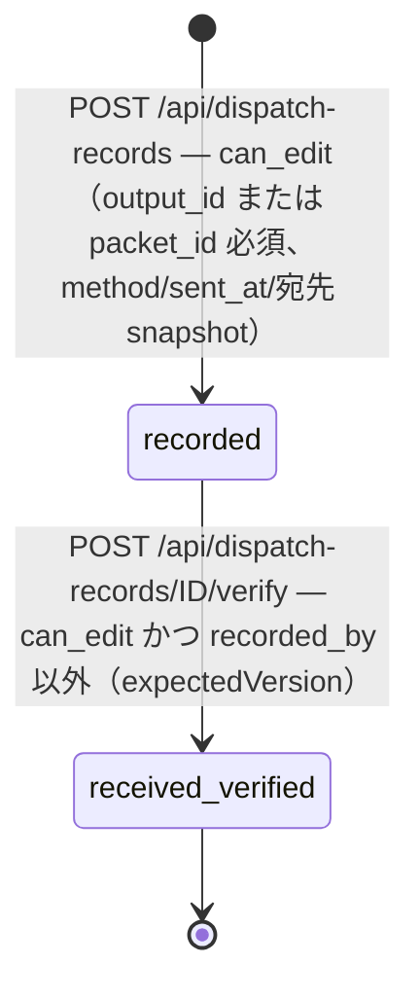

## 11. 編集 lease `edit_leases`

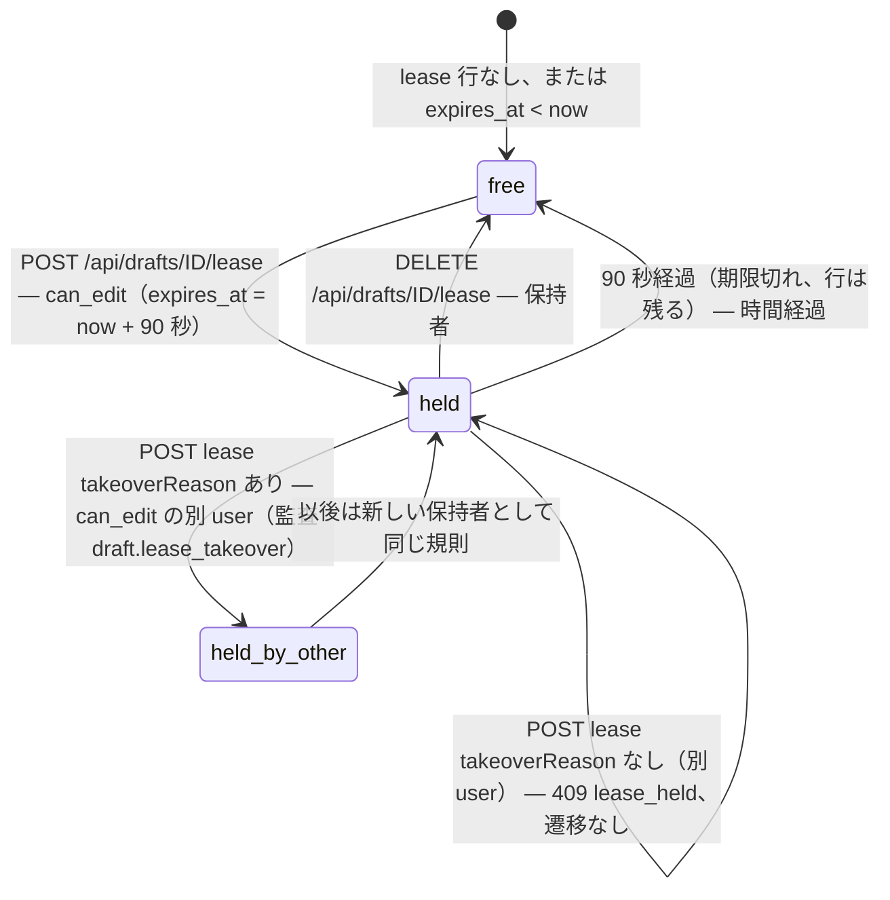

編集系 API（`PUT revisions` / `apply-candidates` / `external-edit`）は `assertLeaseOrFree` で他者保持中を 409 にする。lease 取得自体は編集権限（`can_edit_matter`）を要求する。

## 12. セッション `private.server_sessions`（参考）

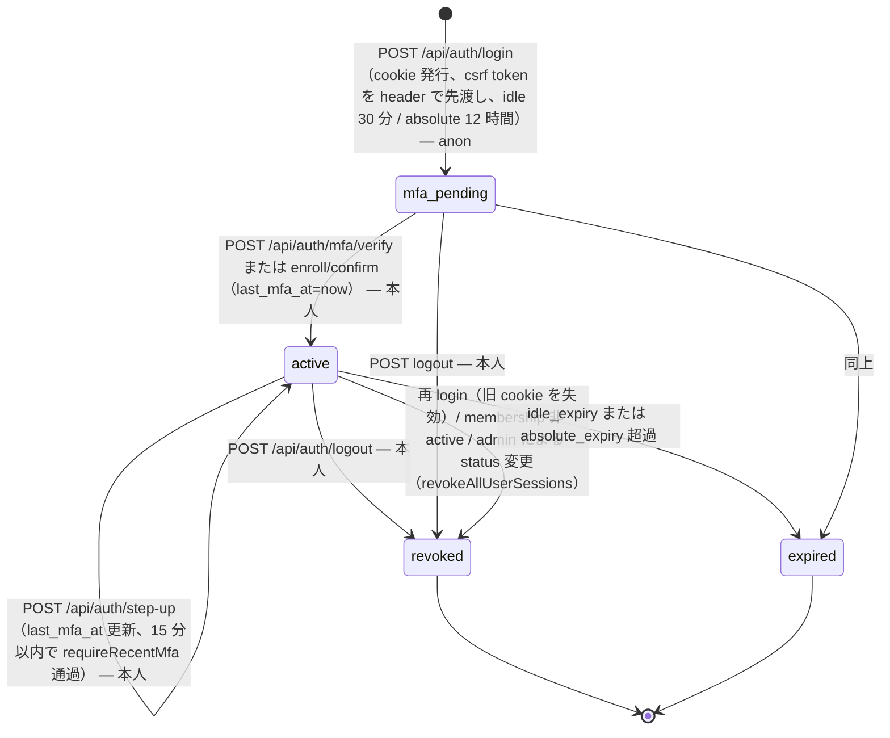
