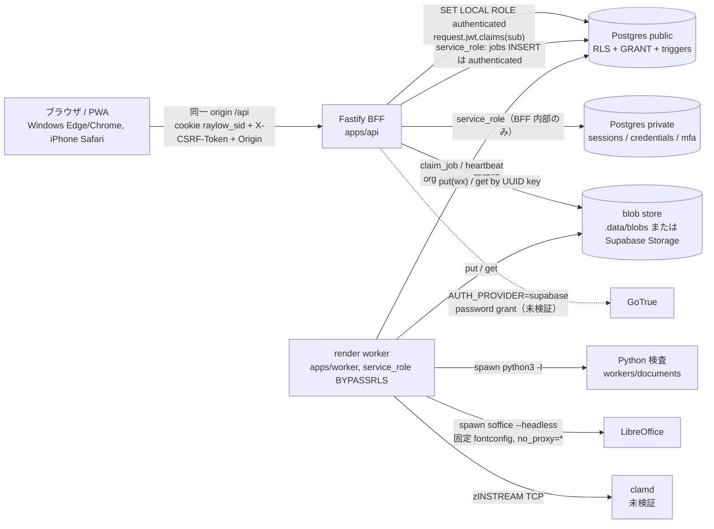

# RayLaw v2 脅威モデル

対象はリポジトリ現状のコード。緩和策は実装済みのものだけを挙げ、未実装・未検証の事項は残余リスクとして明記する。法律事務所の事件情報（依頼者・相手方・本文・原資料）を扱うため、機密性と改ざん検知を最優先とする。

## 1. 保護対象（資産）

| 資産 | 所在 | 価値 |
|---|---|---|
| 事件本文・差込 snapshot・AST | `draft_revisions.snapshot_json / ast_json`（Postgres） | 最高。依頼者・相手方の実名・住所・主張を含む |
| 原資料 bytes・出力 DOCX/PDF・提出パック ZIP | blob store（`.data/blobs/<uuid>` または Supabase private bucket）、`files` / `file_versions` | 最高。改ざんは証拠・提出物の信頼性に直結 |
| 連絡先・案件・当事者・代理人マスター | `contacts`, `matters`, `matter_parties`, `matter_agents` | 高。存在自体が利益相反情報 |
| 承認記録・監査 | `reviews`, `audit_events` | 高。否認防止・改ざん検知 |
| セッション・資格情報・TOTP secret | `private.server_sessions`, `private.local_credentials`, `private.mfa_totp` | 最高 |
| 書式 DOCX とスキーマ | `template_versions` + files(scope=template) | 中〜高。他案件情報の残存、テンプレート注入 |
| 鍵・接続文字列 | `.env`（`SESSION_ENCRYPTION_KEY`, `DATABASE_URL_*`, `SUPABASE_SERVICE_ROLE_KEY`） | 最高 |
| 可用性 | job queue、LibreOffice、clamd | 中。業務停止 |

## 2. 信頼境界

| 境界 | 越えるもの | 検査点 |
|---|---|---|
| ブラウザ → BFF | cookie、CSRF ヘッダ、JSON/multipart/octet-stream | `plugins/auth.ts`（Origin/Referer allowlist、cookie→session、CSRF、MFA、roles）、Zod 契約、bodyLimit 2MB / multipart 100MB |
| BFF → Postgres(public) | SQL（パラメータ化）、`request.jwt.claims` | RLS ポリシー、`app.*` ACL 関数、cross-org トリガ、immutable トリガ、GRANT |
| BFF → Postgres(private) | session/credential 操作 | `withServiceTx` のみ。authenticated は REVOKE ALL |
| worker → Postgres | service_role（RLS を迂回） | handler 内で `org_id`/`matter_id`/hash の再確認（`scope_mismatch`, `hash_mismatch`, `not_approved`） |
| worker → Python/LibreOffice | ファイル bytes（不正入力） | `python3 -I`、env 最小化、timeout 120/300 秒、job ごとの一時ディレクトリ削除、`no_proxy=*`、fontconfig 固定 |
| worker → blob store | bytes | storage key は UUID 正規表現で検証、put は `wx`（上書き不可）、取得後 sha256 を DB 値と照合 |
| worker → clamd | bytes（INSTREAM） | 接続不可は fail closed |

## 3. STRIDE 分析

凡例: S=なりすまし、T=改ざん、R=否認、I=情報漏えい、D=サービス妨害、E=権限昇格。残余リスクは「—」が無い限り対応が必要な事項。

### 3.1 セッション・認証

| # | 脅威 | 種別 | 実装済み緩和策 | 残余リスク |
|---|---|---|---|---|
| A1 | セッション cookie の窃取・再利用 | S | opaque 32 byte トークン、DB には sha256 のみ保存、HttpOnly、SameSite=Lax、idle 30 分 / absolute 12 時間、`revoked_at`、再 login で旧 session 失効（`auth/session.ts`, `routes/auth.ts`） | `secure` 属性は `COOKIE_SECURE=true` のときのみ（既定 false）。本番で HTTPS + `COOKIE_SECURE=true` が必須。`user_agent_hash` は保存のみで照合していない |
| A2 | CSRF（cookie が自動送信される） | S/T | 変更系に `X-CSRF-Token`（session ごと、sha256 保存、`GET /api/auth/session` と MFA 検証で再発行）+ `Origin`/`Referer` allowlist。Origin も Referer も無い非 GET は拒否 | `GET /api/auth/session` の呼び出しごとにトークンがローテーションするため、複数タブで古いトークンを持つと 403（可用性）。CORS は未設定（同一 origin 前提） |
| A3 | パスワード総当たり | S | login は rate limit 10/min/IP、`local_credentials` は 10 回失敗で 15 分 lock、存在しないユーザーにもダミー scrypt 検証（タイミング差低減） | `trustProxy: true` のため `X-Forwarded-For` を偽装できる経路（reverse proxy 未配置）では IP 制限が回避され得る |
| A4 | MFA 未完了での操作 | S/E | `mfa_pending` session は `allowMfaPending` ルート以外 401。TOTP は window 1、使用済み counter の再利用拒否。重要操作（members / settings / publish）は `last_mfa_at` 15 分以内を要求 | `recovery_codes_hash` 列はあるが回復コード生成・利用経路なし（端末紛失時は管理者が再登録する運用）。enroll 応答に secret が平文で含まれる（QR 表示のため、設計上） |
| A5 | Supabase Auth 連携の不備 | S | `identity_links` で auth.users と app_users を対応、refresh token は AES-256-GCM で保存 | **未検証**（GoTrue 未起動）。refresh token を使った更新処理は無い（password grant の結果のみ使用） |
| A6 | 退所者のアクセス継続 | E | `resolveSession` が user/membership の非 active を検出し revoke。`PUT /api/members/:userId` で status 変更時に全 session を revoke | `memberships` を DB 直接で変更した場合は次リクエスト時まで有効 |

### 3.2 認可・テナント分離

| # | 脅威 | 種別 | 実装済み緩和策 | 残余リスク |
|---|---|---|---|---|
| B1 | 他 org のデータ閲覧（IDOR） | I | 全 public 表で RLS（`app.is_org_member` / `can_access_matter`）。BFF は `SET LOCAL ROLE authenticated` + claims で実行。0 行は 404（存在秘匿）。`42501`/`cross_org_reference` も 404 | 非 production では 42501 応答に `details.dbMessage` を含める（`app.ts`、`config.isProd` で抑止） |
| B2 | 他 org の ID を参照列・jsonb に持ち込む | T/I | `app.tg_assert_same_org` を 40 以上の FK 列に設定。`evidence_file_matter` で証拠の原資料が同案件か検査。packet items は `replaceItems` で matter 一致を検査。`template-versions/:id/schema` は UUID 風文字列を拒否 | `recipient_snapshot` / `snapshot_json` 内の ID は差込時に RLS 下の SELECT で解決するため、持込 ID が他 org なら 404。ただし jsonb 内 ID の一般的な認可検証は無い |
| B3 | admin が事件本文を全件閲覧 | E/I | `can_access_matter` に admin 例外なし。監査 org-level 行のみ admin 可視 | — |
| B4 | admin が自分を lawyer にして承認 | E | 自分自身の admin 解除は 403。`is_assigned_lawyer` は `memberships.role='lawyer'` ∧ `lawyers.user_id` ∧ 案件 member を要求 | admin が別 admin を招待し、相互に role を lawyer に変更して `lawyers` 行を作る経路は残る。監査には `member.updated`, `lawyer.created` が残るが二者確認は無い（§20.1 の二者承認は未実装） |
| B5 | API より緩い RLS を突く（DB 直結） | E | API は member/barrier 操作を割当 lawyer に限定 | RLS の `matter_members_write` / `matter_barriers_write` は admin を許可、`template_versions_write`・`matters_insert`（staff 含む）も API より緩い。authenticated ロールの資格情報が漏れた場合は API の制限を迂回できる |
| B6 | export ダウンロードの横取り | I | `GET /api/exports/:jobId/download` は RLS 下で job/file を参照 | `matter_id IS NULL` の export（contacts_csv / matters_csv / audit_csv(org) / **full_backup**）は org member なら誰でも job・file を SELECT でき、要求者本人の確認が無い。job UUID を知る同 org メンバーは admin の全量バックアップを取得できる。要対応 |
| B7 | barrier のあるユーザーが候補・件数から存在を推測 | I | 検索・一覧・job・監査・export すべて RLS 下で実行（AC18）。contacts は org 共有で案件との関係は返さない | `GET /api/reviews`（org 全体）は RLS で絞られるが、`pendingReviews`（/api/home/create）は reviewer 指定の有無で可視範囲が変わる。実測は未検証 |
| B8 | staff による最終承認・書式公開 | E | `checkApproval`（staff_cannot_approve）、publish は `roles:['lawyer']` + MFA + `lawyers` 登録、文例承認は lawyer かつ作成者以外 | — |
| B9 | 自己承認 | R/E | reviewer は revision `created_by` と異なること（依頼時 422、決定時 403） | `created_by` は最後に revision を保存した人。入力の大半を書いた人と別人が最後に保存すれば迂回できる（仕様どおり「最終編集者」基準） |

### 3.3 ファイル・隔離処理

| # | 脅威 | 種別 | 実装済み緩和策 | 残余リスク |
|---|---|---|---|---|
| C1 | 偽 MIME・拡張子偽装 | T/E | `detectMagic`（BFF、finalize 時）+ `check_file.py`（worker）で magic/MIME/拡張子の三者整合、禁止拡張子（docm/dotm/xlsm/exe/js/vbs/html/svg） | text 判定は「先頭 8KB に NUL が無い」のみ。HTML/SVG は先頭 4KB の `<script|<html|<svg` 検査 |
| C2 | ZIP bomb / 巨大展開 / entry 数 | D | `inspect_docx.py` と `check_file.py` が `ZipInfo` の宣言サイズで展開前に判定（圧縮率 100 倍かつ 1MB 超、展開 200MB、2000 entries、path traversal、重複 entry） | 宣言サイズを偽る ZIP（実展開サイズ ≠ file_size）は docxtemplater/PizZip 展開時にメモリを消費する。worker のメモリ上限はコンテナ未定義 |
| C3 | マクロ / OLE / 外部 relationship / altChunk / テキストボックス / 変更履歴 / コメント / 脚注 / 複数セクション / 任意フィールド | E/I/T | `inspect_docx.py` が位置付きで拒否（書式 scope は scan 時にも適用）。外部編集版は macro/OLE/external_rel/altChunk/traversal/bomb を拒否、コメント・変更履歴は警告 | 外部編集版の変更履歴・コメントは PDF に残り得る（警告のみ） |
| C4 | PDF の JavaScript / OpenAction / AA / 埋込ファイル / Launch | E | `check_file.py` が JS・EmbeddedFiles・AA・Launch/SubmitForm/ImportData を拒否、`pdf_sanitize.py` で派生安全版を生成し既定の取得対象に。正式パックの資料 PDF も派生物 | 暗号化 PDF は拒否（解除コピーを促す）。先頭 50 ページのみ注釈アクションを走査 |
| C5 | ウイルス | E | clamd INSTREAM、FOUND で `infected`、接続不可は `scan_failed`（fail closed、job retryable） | **clamd は未検証**。`DEV_ALLOW_UNSCANNED=true` は `NODE_ENV!=='production'` でのみ有効だが、開発環境ではスキャン無しで `clean` になる |
| C6 | 隔離前の取得 | I/E | `scan_status` 既定 `quarantine`、`GET /api/files/:id/content` は clean のみ、出力/パック/export は worker が内部生成として `clean` 挿入 | 書式 import の DOCX は `GET /api/template-versions/:id/docx` で scan 状態を見ずに取得できる（org member 限定、ZIP 構造は inspect 済みが前提） |
| C7 | LibreOffice からの外部取得・サイドチャネル | I | `--headless --norestore --nolockcheck`、`UserInstallation` を job 一時領域に、env を PATH/HOME/FONTCONFIG_FILE/LANG のみに、`no_proxy=*`、fontconfig に alias なし | ネットワーク遮断はコンテナ未定義のため **未実装**。nonroot 実行も未定義 |
| C8 | 一時ファイルの残留 | I | 各 job で `fs.rm(dir, {recursive, force})` を finally で実行 | 強制終了（SIGKILL）時は残る。`.data/tmp` の定期清掃は運用 |
| C9 | blob の改ざん・欠損 | T | `storage_key` UUID、put は `wx`、読み出し時に sha256 を DB 値と照合（render/scan/packet/export/restore） | ローカル FS の権限は OS 任せ。保存時暗号化は未実装 |
| C10 | アップロードのメモリ枯渇 | D | 宣言 size 超過を 413、60 秒 expire、clean up タイマー | `PUT /api/uploads/:id/content` はチャンクをプロセスメモリに保持（最大 100MB × 同時数）。pending Map はプロセスローカルで、複数 API プロセス構成では init と content が別プロセスに行くと 404（HANDOFF 記載の制約） |
| C11 | CSV import の中間状態 | D/I | preview → commit は 10 分有効の `importToken`（プロセスメモリ）、actor/org 一致を検査、commit 直前に全行再検査 | 同じくプロセスローカル。token は UUID だが本人以外は 404 |

### 3.4 テンプレート注入・レンダリング

| # | 脅威 | 種別 | 実装済み緩和策 | 残余リスク |
|---|---|---|---|---|
| D1 | タグによる任意コード・プロパティ探索（`{a.b}`, `{__proto__}`, 式・パイプ） | E/T | `isSafeTagKey`（`^[a-z][a-z0-9_]{0,63}$`、dot/危険キー拒否）を inspector・schema・renderer の三箇所で適用。docxtemplater `parser` を固定し `Object.prototype.hasOwnProperty` 経由でのみ値を取得。`RenderData` は `Object.create(null)`。`nullGetter` は例外（黙って空にしない） | `has_*` 接頭キーは schema 外でも許可（array の有無フラグ用） |
| D2 | 入力値による XML 破壊・raw XML 挿入 | T/E | docxtemplater が文字列を XML escape、`linebreaks:true` で改行のみ `w:br` 化。raw XML module は不使用 | — |
| D3 | 未置換タグの漏れ（他人の情報が残る/タグが露出） | I/T | render 前に `findUnreplaced`、render 後に `scanLeftoverTags`（document/header/footer のタグ風文字列）で失敗、preflight `unreplaced_tag` | 本文入力に含まれる `{key}` 風文字列は差込されず、preflight で `confirm`（理由付き確認） |
| D4 | 書式に他案件の実名・住所が残る | I | `residualTextCandidates`（郵便番号・電話・住所・メール様パターン）、publish に `residualTextReviewed:true` を要求 | 完全自動検知は保証しない（仕様どおり）。人名のみの残存は検出対象外 |
| D5 | 書式差し替え（published 後の DOCX/スキーマ変更） | T | `tg_template_version_immutable`、render 時に blob sha256 と `docx_sha256` を照合 | — |
| D6 | 草案表記の欠落（草案を正式物と誤認） | T | `document_status_label` タグが無い書式には本文先頭へ太字段落を自動挿入、final のみ空ラベル、sample_only は「サンプル・要確認」 | — |
| D7 | 正式版の metadata 漏えい | I | final は `docProps/core.xml` の creator 等を空にし `custom.xml` を除去、`pdf_fonts.py` が metadata を報告 | PDF 側の `/Producer` 等は LibreOffice 既定のまま |

### 3.5 承認・ハッシュ・不変性

| # | 脅威 | 種別 | 実装済み緩和策 | 残余リスク |
|---|---|---|---|---|
| E1 | 承認対象のすり替え（承認後に本文を変える） | T/R | `draft_revisions` immutable、hash = sha256(canonicalJson({snapshot, ast, templateVersionId}))、review に `target_hash` と PDF sha を固定、決定時に現在 revision・hash・PDF sha・書式 published・preflight を transaction 内で再検証（stale は 409）。承認後の編集は `status→draft` と review `withdrawn` | DOCX sha は記録のみ（再照合は PDF のみ）。rendererProfile は template_version の不変列として間接的に固定 |
| E2 | 正式版の不正取得 | I/T | `mode=final` は `draft.status='approved'` ∧ `approved_revision_id=revision_id` ∧ 承認 review の `target_hash` = revision hash を要求。worker も `render_final` で `not_approved` / `template_sample_only` を検査 | — |
| E3 | 確定 bytes の上書き | T | `tg_draft_outputs_guard`（file_id/sha256/format/mode/revision_id 不変、DELETE 不可）、`file_versions_immutable`、blob put `wx` | `file_versions_immutable` は `scan.ts` の `encoding_name` 更新と衝突する（テキスト添付の scan が失敗する）。要修正 |
| E4 | 二重成果物・二重遷移（再送） | T | `jobs_dedupe_uq`（queued/running）、drafts/batches の idempotency_key、`succeeded` 更新は `state='running' AND worker_id=自分`、`approved` 更新は `current_revision_id` 一致条件、`expectedVersion`（409 + currentVersion） | `test_template` / `export` は `nonce` を含むため dedupe しない（意図的） |
| E5 | ジョブ lease の奪い合い | T/D | `FOR UPDATE SKIP LOCKED`、lease 120 秒、heartbeat 30 秒、lease 切れは requeue、`lease_lost` 検出 | heartbeat が止まった worker の処理が lease 切れ後も継続すると、結果書込みは `lease_lost` で捨てられるが外部副作用（blob put）は残る |

### 3.6 監査・否認防止・ログ

| # | 脅威 | 種別 | 実装済み緩和策 | 残余リスク |
|---|---|---|---|---|
| F1 | 監査の改ざん・削除 | T/R | `audit_events_append_only` トリガ + `REVOKE UPDATE, DELETE`（authenticated, service_role）。業務変更と同一 transaction で INSERT（`services/audit.ts`、worker handler） | superuser/owner は迂回可能。DB 直接操作の記録は Postgres 側ログに依存（未設定） |
| F2 | 監査に機密本文が入る | I | `details` に本文を入れない運用、記録するのは ID・version・hash・件数 | 一部 `details` に `reason`（差戻し理由、引継ぎ理由、訂正理由）の原文が入る |
| F3 | ログへの秘密・本文流出 | I | Fastify redact（cookie / authorization / x-csrf-token）、worker は `payload.snapshot` / `payload.ast` を redact、health は `{ok,time}` のみ | unhandled error の `err` オブジェクトに SQL 文や値が含まれ得る。42501 の `dbMessage` は非 production のみ |
| F4 | 否認（誰が承認・取得したか） | R | 承認・出力取得・パック取得・export 取得・lease 引継ぎ・barrier 追加等を `actor_id / request_id / target_hash` 付きで記録 | — |

### 3.7 秘密情報・設定

| # | 脅威 | 種別 | 実装済み緩和策 | 残余リスク |
|---|---|---|---|---|
| G1 | `.env` の漏えい | I | `.gitignore`、`.env.example` に値を置かない、`SESSION_ENCRYPTION_KEY` は 32 byte base64 を起動時検証、TOTP secret / refresh token は AES-256-GCM | 鍵と DB 接続文字列が同一ファイル。secret manager 分離・ローテーションは未実装 |
| G2 | seed 資格情報の流出 | S | `randomToken` 生成、`.data/seed-credentials.json`（0600、.gitignore）、MFA secret も seed 時生成 | 開発専用。デモ環境を外部公開するとファイルが残る |
| G3 | 招待時の初期パスワード | S | 応答で一度だけ返却、`must_change=true` | `must_change` を強制する UI/API は未実装 |
| G4 | `DEV_ALLOW_UNSCANNED` の本番混入 | E | API/worker 双方で `NODE_ENV !== 'production'` を条件、job payload にも flag を持ち二重に判定 | 本番で `NODE_ENV` を誤設定すると有効化される |

### 3.8 クライアント（PWA）

| # | 脅威 | 種別 | 実装済み緩和策 | 残余リスク |
|---|---|---|---|---|
| H1 | SW キャッシュに機密が残る | I | `sw.js` は `/api/*` を触らず、`Content-Disposition` 付き・PDF/DOCX/ZIP/octet-stream・`no-store` 応答を cache しない。navigation は network-only、静的 shell のみ cache。API は全応答 `Cache-Control: no-store` | ブラウザの bfcache・ダウンロードフォルダは制御外 |
| H2 | ログアウト後・bfcache 復帰で旧画面が見える | I | `queryClient.clear()`、`sessionStore.reset()`、`pageshow persisted` で再検証、`SessionDialogs` が 401 で再ログイン→権限再確認 | 実機（iPhone Safari）での確認は未実施 |
| H3 | localStorage/IndexedDB への機密保存 | I | セッションはメモリのみ。localStorage はタブ選択の記憶（`TAB_PREF_KEY`）のみ | — |
| H4 | 編集中の強制 reload による原稿喪失 | D | `unsavedRegistry` が空のときだけ `SKIP_WAITING`、`beforeunload` 警告、700ms autosave | — |
| H5 | 403/404 の文言差による存在推測 | I | `ApiError.userMessage()` は 403/404 を同一文言 | — |

## 4. 対応が必要な残余リスク（優先順）

1. **B6** export ダウンロードに要求者本人の確認が無く、org メンバーが admin の `full_backup` を取得できる。
2. **E3** `file_versions_immutable` トリガと `scan.ts` の `encoding_name` 更新の衝突（テキスト添付の scan 失敗）。
3. **B5** RLS が API より緩い箇所（admin の matter_members/barriers 書込み、org member の template_versions 書込み、staff の matters INSERT）。DB 資格情報漏えい時の二重防御として RLS 側を API に合わせる。
4. **C5 / C7 / A5** ClamAV、nonroot/network-off コンテナ、Supabase Auth/Storage が未検証・未実装。
5. **B4** admin 2 名による相互 role 変更の経路。二者承認（§20.1）の実装。
6. **C10 / C11** upload/import の進行状態がプロセスメモリ。複数プロセスでは sticky session か共有ストアが必要。
7. **A1** `COOKIE_SECURE` 既定 false。本番は true 必須。
8. **G3** `must_change` の強制。
9. **F2** 監査 `details` の理由原文。
